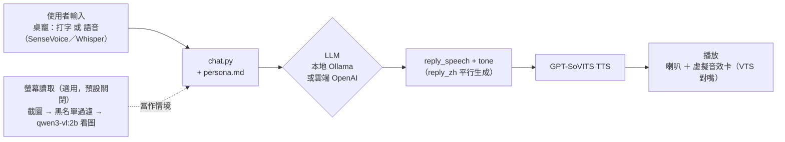

# LLM Voice Chatbot

一個**完全本地優先、也可選雲端**的角色語音聊天平台：LLM 生成台詞、GPT-SoVITS 生成語音，透過飄浮在桌面上的透明立繪視窗（「桌寵」）互動。內建範例角色（BanG Dream! Ave Mujica 的豐川祥子）僅供展示接線方式，平台本身設計成可換成任何角色。

姊妹專案 [voice-dataset-toolkit](https://github.com/kukuo2510/voice-dataset-toolkit) 負責從你自己的素材訓練新角色的聲音。

A **local-first, cloud-optional** character voice chatbot: an LLM writes in-character replies, GPT-SoVITS voices them, and you talk to it via a floating, borderless desktop-pet window. Sister project [voice-dataset-toolkit](https://github.com/kukuo2510/voice-dataset-toolkit) trains a new character's voice from your own footage.

---

## 這個平台做什麼 / What it does

- 打字或按住熱鍵語音輸入，角色用語音回覆＋文字翻譯＋語氣標籤（開心/嚴肅/猶豫…），TTS 依語氣切換聲音表現
- 角色說話的語言可設定（桌寵右鍵選單「角色說話語言」子選單即時切換，常見語言直接點，其他語言用「自訂...」輸入；或 `.env` 的 `CHARACTER_SPEECH_LANGUAGE` 設起始值），預設日文，換角色時不用改程式碼
- 桌面上飄浮的透明立繪視窗（「桌寵」），無邊框、只有角色本人；滾滑鼠滾輪可即時縮放大小
- 對話用的 LLM/STT 可以是本地（Ollama/SenseVoice，免費）或雲端（OpenAI），桌寵右鍵選單隨時可切換，不用改 `.env`、不用重開程式
- 選用功能：桌寵會定期看一眼螢幕、自己決定要不要主動找你聊天（見下方架構圖）。右鍵選單「遊戲模式（少看螢幕）」可以讓它少看幾次、讓出顯示卡
- 「分段播放（先講先播）」開關：開著時一句合成完就先播，關掉則整段合成完一口氣播出，不會中途停頓
- 選用：接 Claude Code 的 hook（`scripts/desktop_pet/claude_hook.py`，UDP 9892），Claude 在等你確認權限、或做完超過 1 分鐘的工作時，角色會開口提醒；只傳事件種類，不傳你交辦的內容
- 選用的 LivLiv 舞台：用 Electron 透明視窗畫會動、會對嘴的角色，取代兩張 PNG 的立繪（見 [`../livliv-stage/README.md`](../livliv-stage/README.md)）

- Type or hold a hotkey to talk; the character replies with voice + a text translation + a tone tag (happy/serious/hesitant...), and TTS switches its delivery to match
- Character speech language is configurable (the desktop pet's right-click "Character Speech Language" submenu switches it instantly — common languages are one click away, anything else via "Custom..."; or set a starting value with `.env`'s `CHARACTER_SPEECH_LANGUAGE`), defaults to Japanese, no code changes needed when swapping characters
- A floating, transparent character window (the "desktop pet") — borderless, only the character itself is visible; scroll the mouse wheel over it to resize instantly
- LLM/STT can be local (Ollama/SenseVoice, free) or cloud (OpenAI), switchable anytime from the desktop pet's right-click menu, no `.env` edits or restart needed
- Optional: the desktop pet periodically glances at your screen and decides on its own whether to start a conversation (see architecture diagram below). A right-click "Game mode" toggle makes it look less often to free up the GPU
- A "chunked playback" toggle: on, each sentence plays as soon as it's synthesized; off, the whole reply is synthesized first and played without pauses
- Optional LivLiv stage: an Electron transparent window that draws an animated, lip-syncing character instead of two PNG frames (see [`../livliv-stage/README.md`](../livliv-stage/README.md))

---

## 架構 / Architecture



---

## 踩過的坑 / Problems → Fixes

- 本地/雲端悄悄切換，使用者搞不清楚在跑哪個 → 明確選擇，不偵測 key 存在就自動切
- 看圖模型描述太籠統、角色只會講空話 → 提示詞明講「要具體細節」，不是模型能力不夠
- TTS 唸到一半像拖了一下 → 斷句方法 `cut5`（連逗號都切）換成 `cut3`（只在句號切）
- 螢幕截圖涉及隱私 → 排除清單（黑名單視窗直接跳過擷取）+ 預設關閉 + 主動詢問同意
- 改 `.env` 才能切換功能，門檻太高 → 改成右鍵選單即時切換 + 記住選擇
- 看螢幕吃掉 5.4 GB 顯示記憶體、一次 27 秒 → 截圖縮到長邊 1280、限制 context、換視窗或隔一段時間才真的看圖，其他時候沿用上次的描述
- 角色常常用低沉的「嚴肅」語氣講話 → 把 serious 限定在真的生氣、訓人的時候
- 切成中文還是講日文、講日文時夾中文詞 → 每則訊息最後補一句「只能用某語言」的提醒（離生成位置越近越有效）

- Silent local/cloud switching left users unsure which one was actually running → explicit selection required, never auto-switches just because a key happens to be set
- Vision-model captions were too vague, so the character only gave empty responses → the prompt now explicitly demands concrete detail; this was a prompt problem, not a model-capability ceiling
- TTS sounded like it dragged mid-sentence → switched the sentence-splitting method from `cut5` (splits on every punctuation mark) to `cut3` (splits only at periods)
- Screen capture touches on privacy → an exclusion list (blacklisted windows skip capture entirely) + off by default + an explicit opt-in prompt
- Editing `.env` just to toggle a feature was too high a barrier → switched to right-click menu toggles that remember your choice
- Screen watching took 5.4 GB of VRAM and 27 s per look → downscale screenshots to 1280 px, cap the context, and only run the vision model when the window changes or after an interval, reusing the last caption otherwise
- The character often spoke in the low "serious" tone → serious is now reserved for genuine anger or scolding
- Switching to Chinese still produced Japanese, and Japanese replies leaked Chinese words → a short "reply only in X" reminder is appended to every message (rules closest to the generation point work best)

---

## 安裝與執行 / Setup & Run

```bash
conda create -n tts-platform python=3.10 && conda activate tts-platform
pip install -r requirements.txt

# GPT-SoVITS 是獨立上游專案，另外 clone 到這個 repo 根目錄下的 GPT-SoVITS/
git clone https://github.com/RVC-Boss/GPT-SoVITS
# 並先 ollama pull qwen2.5:14b（對話）、ollama pull qwen3-vl:2b（選用，螢幕讀取用）

copy .env.example .env   # 填入需要的 token/key，細節見檔案內註解
```

雙擊 `start_desktop_pet_hidden.vbs` 啟動：在背景依序開 TTS 服務（已經開著就沿用）、LivLiv 舞台、桌寵，全程沒有黑視窗，輸出寫到 `logs/tts.log`、`logs/pet.log`。從桌寵右鍵選單結束時，舞台和它自己開的 TTS 服務會一起關；萬一卡住，雙擊 `stop_desktop_pet_hidden.bat` 強制全部關掉。舞台要換角色，在啟動前設環境變數 `LIVLIV_MODEL`（預設 `sakiko404`）。

搬到另一台 Windows 電腦：雙擊 `scripts/new_pc/pack.bat`，會把程式、聲音模型、舞台、設定和 Python 套件的確切版本打包到 `D:\desktop_pet_package`；整個資料夾複製到新電腦，雙擊裡面的 `install.bat`，自動裝好 Miniconda、Python 環境、Node.js、Ollama 和模型，並在桌面建立捷徑。

換成自己的角色：複製 `characters/sakiko/` → `characters/<角色>/`，換掉 `persona.md`、`voice_config.py`、`avatar/` 內容，語氣參考音檔要自己準備好（`voice-dataset-toolkit` 訓練/匯出的產物，或自己錄的），再把 `tts_infer.py`/`chat.py`/`desktop_pet.py` 裡寫死 `sakiko` 的路徑換掉。角色講不同語言的話，記得改 `.env` 的 `CHARACTER_SPEECH_LANGUAGE`，並把 `voice_config.py` 的 `PRONUNCIATION_FIXES`（目前是日文專屬的讀音修正表）換成你自己語言需要的版本。

Double-click `start_desktop_pet_hidden.vbs` to launch: it starts the TTS server (reusing one that's already running), the LivLiv stage and the desktop pet in the background with no console windows, logging to `logs/tts.log` and `logs/pet.log`. Quitting the pet from its right-click menu also closes the stage and the TTS server it started; if something hangs, double-click `stop_desktop_pet_hidden.bat` to force everything closed. To use another stage character, set the `LIVLIV_MODEL` environment variable before launching (default `sakiko404`).

To use your own character: copy `characters/sakiko/` to `characters/<your-character>/`, replace `persona.md`, `voice_config.py`, and the `avatar/` assets, and provide your own tone-reference audio clips (exported/trained via `voice-dataset-toolkit`, or recorded yourself). Then update the hardcoded `sakiko` paths in `tts_infer.py`/`chat.py`/`desktop_pet.py`. If your character speaks a different language, set `.env`'s `CHARACTER_SPEECH_LANGUAGE` accordingly, and replace `voice_config.py`'s `PRONUNCIATION_FIXES` (currently a Japanese-specific pronunciation-correction table) with whatever your language needs.

---

## 版權與內容聲明 / Copyright & Content

這個 repo 只包含**工具程式碼**，不含任何動畫/影片素材、字幕、訓練音檔（含 `characters/*/voice_refs/`）、微調好的模型權重、`.env` 裡的金鑰。使用這些工具處理的任何第三方著作權內容，版權歸原作者所有，使用者需自行負責取得合法授權；範例角色內容（`characters/sakiko/`）僅供展示接線方式，不代表官方授權內容。

This repository ships **tooling only** — no anime footage, subtitles, training audio, fine-tuned model weights, or secrets. Any third-party copyrighted material you process with these tools remains the property of its original rights holders; you are responsible for using it lawfully.

程式碼採 [MIT License](LICENSE)，只涵蓋這個 repo 裡的程式碼，不代表你對第三方素材有任何授權。
