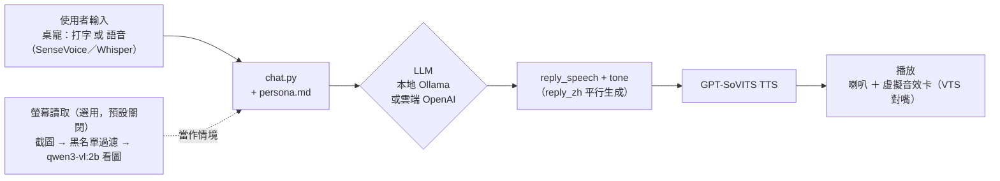

# LLM Voice Chatbot

一個**完全本地優先、也可選雲端**的角色語音聊天平台：LLM 生成台詞、GPT-SoVITS 生成語音，透過飄浮在桌面上的透明立繪視窗（「桌寵」）互動。內建範例角色（BanG Dream! Ave Mujica 的豐川祥子）僅供展示接線方式，平台本身設計成可換成任何角色。姊妹專案 [voice-dataset-toolkit](https://github.com/kukuo2510/voice-dataset-toolkit) 負責從你自己的素材訓練新角色的聲音。

A **local-first, cloud-optional** character voice chatbot: an LLM writes in-character replies, GPT-SoVITS voices them, and you talk to it via a floating, borderless desktop-pet window. Sister project [voice-dataset-toolkit](https://github.com/kukuo2510/voice-dataset-toolkit) trains a new character's voice from your own footage.

> Windows only（桌寵視窗用了 Windows 專屬的透明視窗技巧）。

---

## 這個平台做什麼 / What it does

- 打字或按住熱鍵語音輸入，角色用語音回覆＋文字翻譯＋語氣標籤（開心/嚴肅/猶豫…），TTS 依語氣切換聲音表現
- 角色說話的語言可設定（桌寵右鍵選單「角色說話語言」子選單即時切換，常見語言直接點，其他語言用「自訂...」輸入；或 `.env` 的 `CHARACTER_SPEECH_LANGUAGE` 設起始值），預設日文，換角色時不用改程式碼
- 桌面上飄浮的透明立繪視窗（「桌寵」），無邊框、只有角色本人；滾滑鼠滾輪可即時縮放大小
- 對話用的 LLM/STT 可以是本地（Ollama/SenseVoice，免費）或雲端（OpenAI），桌寵右鍵選單隨時可切換，不用改 `.env`、不用重開程式
- 選用功能：桌寵會定期看一眼螢幕、自己決定要不要主動找你聊天（見下方架構圖）

---

## 架構 / Architecture



---

## 踩過的坑 / Problems → Fixes

- 本地/雲端悄悄切換，使用者搞不清楚在跑哪個 → 明確選擇，不偵測 key 存在就自動切
- 看圖模型描述太籠統、角色只會講空話 → 提示詞明講「要具體細節」，不是模型能力不夠
- TTS 唸到一半像拖了一下 → 斷句方法 `cut5`（連逗號都切）換成 `cut3`（只在句號切）
- 螢幕截圖涉及隱私 → 排除清單（黑名單視窗直接跳過擷取）+ 預設關閉 + 主動詢問同意
- 改 `.env` 才能切換功能，門檻太高 → 改成右鍵選單即時切換 + 記住選擇

---

## 安裝與執行 / Setup & Run

```bash
conda create -n tts-platform python=3.10 && conda activate tts-platform
pip install -r requirements.txt

# GPT-SoVITS 是獨立上游專案，另外 clone 到這個 repo 根目錄下的 GPT-SoVITS/
git clone https://github.com/RVC-Boss/GPT-SoVITS
# 並先 ollama pull qwen2.5:14b（對話）、ollama pull qwen3-vl:2b（選用，螢幕讀取用）

copy .env.example .env   # 填入需要的 token/key，細節見檔案內註解
```

雙擊 `.bat` 檔啟動：`start_desktop_pet.bat`（桌寵）、`talk_to_sakiko.bat`（終端機 demo）、`start_tts_inference.bat`（TTS 服務，通常不用手動開，其他入口點會自動偵測啟動）。

換成自己的角色：複製 `characters/sakiko/` → `characters/<角色>/`，換掉 `persona.md`、`voice_config.py`、`avatar/` 內容，語氣參考音檔要自己準備好（`voice-dataset-toolkit` 訓練/匯出的產物，或自己錄的），再把 `tts_infer.py`/`chat.py`/`desktop_pet.py` 裡寫死 `sakiko` 的路徑換掉。角色講不同語言的話，記得改 `.env` 的 `CHARACTER_SPEECH_LANGUAGE`，並把 `voice_config.py` 的 `PRONUNCIATION_FIXES`（目前是日文專屬的讀音修正表）換成你自己語言需要的版本。

---

## 版權與內容聲明 / Copyright & Content

這個 repo 只包含**工具程式碼**，不含任何動畫/影片素材、字幕、訓練音檔（含 `characters/*/voice_refs/`）、微調好的模型權重、`.env` 裡的金鑰。使用這些工具處理的任何第三方著作權內容，版權歸原作者所有，使用者需自行負責取得合法授權；範例角色內容（`characters/sakiko/`）僅供展示接線方式，不代表官方授權內容。

This repository ships **tooling only** — no anime footage, subtitles, training audio, fine-tuned model weights, or secrets. Any third-party copyrighted material you process with these tools remains the property of its original rights holders; you are responsible for using it lawfully.

程式碼採 [MIT License](LICENSE)，只涵蓋這個 repo 裡的程式碼，不代表你對第三方素材有任何授權。
