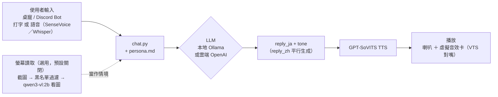

# TTS 角色語音平台 / Local Character Voice Chatbot Platform

一個**完全本地、免費**的角色語音聊天平台：本地 LLM（Ollama）生成角色台詞、本地 TTS（GPT-SoVITS）生成語音，可以透過 Discord bot、終端機、或一個飄在桌面上的無邊框透明立繪視窗（「桌寵」）互動。目前內建的範例角色是《BanG Dream! Ave Mujica》的豐川祥子，但整個平台是設計成**可以換成你自己的角色**的。

A **fully local, free** character voice chatbot platform: a local LLM (Ollama) writes in-character replies, a local TTS engine (GPT-SoVITS) voices them, and you talk to it via a Discord bot, a terminal, or a borderless floating avatar window ("desktop pet"). The bundled example character is Sakiko Togawa (BanG Dream! Ave Mujica), but the platform is built to be **repointed at your own character**.

> **只支援 Windows。** 桌寵視窗用了 Windows 專屬的透明視窗技巧，`.bat` 啟動腳本、`os.startfile` 等也都是 Windows 專屬。
> **Windows only.** The desktop-pet window uses a Windows-specific transparency trick, and the launcher scripts / `os.startfile` calls are Windows-specific too.

> 這個 repo 只負責「跑一個已經有台詞人設＋語音模型的角色」。如果你想從自己的影片素材**從零開始做一個新角色的語音**（切片、標注、匯出訓練資料），那是姊妹專案 **dataset-toolkit** 的工作，見下方「換成你自己的角色」。
> This repo only runs a character that already has a persona and a fine-tuned voice model. If you want to **build a new character's voice from scratch** from your own footage (clipping, labeling, exporting training data), that's the sister project **dataset-toolkit** — see "Repoint at your own character" below.

---

## 功能 / Features

- **本地 LLM 對話**：Ollama（預設 qwen2.5:14b）生成角色的日文回覆＋中文翻譯＋語氣標籤（neutral/happy/serious/hesitant/intense），全部走 JSON 結構化輸出（`scripts/llm/chat.py`）
- **本地 TTS**：GPT-SoVITS 微調角色語音模型，依語氣標籤切換參考音檔（`scripts/gpt_sovits/tts_infer.py`）
- **可選雲端 LLM/STT**：預設完全本地免費，想換成 OpenAI 就在 `.env` 明確設定 `LLM_PROVIDER=openai`／`STT_PROVIDER=openai`＋填 `OPENAI_API_KEY`（不會因為環境裡剛好有 key 就自動切走，一定要你自己選）
- **桌寵視窗**：無邊框、背景全透明的浮動角色視窗（Windows 色鍵去背），只有角色本人飄在桌面上，點角色彈出輸入列、拖曳移動、右鍵選單、依音量開合嘴（`scripts/desktop_pet/desktop_pet.py`）
- **螢幕讀取主動搭話（選用，預設關閉）**：桌寵可以定期看一眼你的螢幕、自己決定要不要主動開口講話，不用你先打字/按熱鍵（`scripts/desktop_pet/screen_watch.py`）。**這個功能會把螢幕截圖送去一個看圖用的本地模型（預設 `qwen3-vl:2b`）**，涉及隱私，所以第一次啟動桌寵會直接跳出視窗問你要不要開啟（可以順便勾選「記住這個選擇」），之後也能隨時用右鍵選單切換開關，不用去改設定檔。啟用前請先看下方「螢幕讀取的隱私設計」
- **Discord bot**：文字或直接在語音頻道講話，bot 進頻道用語音回覆（`scripts/discord_bot/bot.py`）
- **語音輸入**：桌寵用 push-to-talk（F9，SenseVoice 轉文字）；Discord bot 走 `discord-ext-voice-recv` + faster-whisper

---

## 架構 / Architecture



**跟姊妹專案 dataset-toolkit 的關係**：上圖的 `characters/<角色>/voice_refs/` 參考音檔＋微調好的 GPT-SoVITS 模型，是 dataset-toolkit 那邊的產出，這個 repo 本身不處理原始素材，只負責拿現成的東西來跑。

---

## 事前準備 / Prerequisites

- Windows，[Miniconda](https://docs.conda.io/en/latest/miniconda.html)（或 Anaconda）
- [Ollama](https://ollama.com/)，並 `ollama pull qwen2.5:14b`（或改用別的模型，見下方環境變數）
- [GPT-SoVITS](https://github.com/RVC-Boss/GPT-SoVITS) 另外 clone 到這個 repo 根目錄下的 `GPT-SoVITS/` 資料夾，照它自己的 README 安裝好依賴（這份專案沒有把它包進來，`.gitignore` 也刻意排除它——它是獨立的上游專案，體積太大且有自己的版本節奏）
- ffmpeg 要在系統 PATH 裡（Discord bot 語音播放需要）
- （選用）[VB-Audio Virtual Cable](https://vb-audio.com/Cable/)：只有還想另外接 VTube Studio 做 Live2D 對嘴才需要，桌寵視窗本身不依賴它——找不到虛擬音效卡時桌寵照樣正常運作，只是不會有 VTS 對嘴輸出
- （選用）想開啟「螢幕讀取主動搭話」才需要：`ollama pull qwen3-vl:2b`，並且 `pip install pywin32 psutil`（已含在 `requirements.txt`）——見下方「螢幕讀取功能的隱私注意事項」

## 安裝 / Setup

```bash
conda create -n tts-platform python=3.10
conda activate tts-platform
pip install -r requirements.txt

# 另外照 GPT-SoVITS 自己的說明裝：
git clone https://github.com/RVC-Boss/GPT-SoVITS
# cd GPT-SoVITS && 照它的 install.sh / install.ps1 走

# 複製 .env.example 為 .env，填入你自己的 DISCORD_BOT_TOKEN（沒有要跑 Discord bot 可以不填）
copy .env.example .env
```

`.bat` 啟動腳本預設呼叫 `C:\miniconda3\envs\tts-platform\python.exe`；如果你的 conda 裝在別的地方，設環境變數 `TTS_PLATFORM_PYTHON` 指向你自己的直譯器路徑就好，不用改 `.bat` 檔本身。

同樣道理，`OLLAMA_URL`、`OLLAMA_MODEL`、`TTS_API_URL` 都能用環境變數覆蓋（預設值分別是 `http://localhost:11434/api/chat`、`qwen2.5:14b`、`http://127.0.0.1:9880/tts`）。

## 執行 / Running

雙擊這個 repo 根目錄的 `.bat` 檔（或用對應的 conda 環境直接跑 `.py`）：

| 檔案 | 做什麼 |
|---|---|
| `start_tts_inference.bat` | 啟動 GPT-SoVITS 推理服務（其他入口點會自動偵測、需要的話自動幫你啟動，通常不用手動跑這個） |
| `start_desktop_pet.bat` | 桌寵視窗 |
| `start_discord_bot.bat` | Discord bot |
| `talk_to_sakiko.bat` | 終端機互動 demo |

---

## 螢幕讀取功能的隱私注意事項

開啟後，桌寵會定期（預設每 20 秒，`SCREEN_WATCH_INTERVAL_SEC` 可調，選這個頻率是為了做出陪伴感，代價是看圖模型在背景被呼叫得比較頻繁、比較佔 GPU）截一次螢幕圖，送給本地看圖模型（預設 `qwen3-vl:2b`，需要先 `ollama pull qwen3-vl:2b`）轉成文字描述，再讓角色決定要不要根據這個描述主動跟你搭話。如果剛好在忙（跟她聊天中）或輸入框開著，不會插話，會記著等你這邊空下來再補做，補做時會重新截圖抓當下最新畫面。請注意：

- **截圖只會送去本地模型（Ollama），不會離開你的電腦**——除非你同時把 `LLM_PROVIDER`/看圖這步也改接雲端（目前程式碼固定用本地 Ollama 看圖，沒有雲端看圖選項）
- **有一份排除清單**（`scripts/desktop_pet/screen_watch.py`）：擷取螢幕前會先檢查目前作用中視窗的標題／程式名稱，命中黑名單就直接跳過、連截圖都不產生。預設黑名單只涵蓋幾個常見類別（密碼管理器、含「bank／銀行／password／密碼」關鍵字的視窗），**不是萬用的內容過濾**——這是刻意的設計取捨：連 Microsoft Recall 那種規模的團隊做「AI 判斷畫面內容敏不敏感」都測出不可靠，所以這裡選擇可靠但陽春的字串比對，而不是假裝能自動偵測所有敏感內容。想擋更多 App／視窗，自己在 `.env` 的 `SCREEN_WATCH_BLOCKED_PROCESSES`／`SCREEN_WATCH_BLOCKED_TITLE_KEYWORDS` 加
- **開關預設關閉，第一次啟動桌寵會跳出詢問視窗，可以選擇要不要記住這次選擇**（記住的話存在 `scripts/desktop_pet/.screen_watch_pref.json`，這個檔案不進版控）；右鍵選單隨時可以切換，不用重開程式、也不用碰 `.env`
- 目前看圖模型（2B 規模）看單一人像類圖片準確度不錯，但看複雜的真實桌面截圖（多視窗、UI介面）理解力有限，這是已知限制，還沒有解法

---

## 換成你自己的角色 / Repoint at Your Own Character

角色相關的東西都收在 `characters/<角色名>/` 底下：

```
characters/sakiko/
  persona.md          # 人設、說話風格、語氣指示（純文字，LLM 生成回覆時會讀這份）
  voice_config.py      # 語氣參考音檔對照表、發音修正字典、SPEAKER_NAME
  voice_refs/          # 語氣參考音檔（不進版控，見下方版權提醒），换角色要自己放
  avatar/
    mouth_open.png     # 桌寵立繪，完整角色圖，嘴巴開著
    mouth_closed.png   # 同一張圖，嘴巴閉著
```

換角色的最終步驟就是：複製一份 `characters/sakiko/` → `characters/<你的角色>/`，把內容換成你自己的，再把 `scripts/gpt_sovits/tts_infer.py` 和 `scripts/desktop_pet/desktop_pet.py` 裡 import/路徑寫 `sakiko` 的那一行改成你的角色名。

> **在那之前，你需要先有「語氣參考音檔」和「微調好的 GPT-SoVITS 模型」**——這兩樣東西是姊妹專案 **dataset-toolkit** 從你自己的影片素材做出來的（切片 → 標注 → 匯出 → 訓練）。這個 repo 本身不處理原始素材，只負責「拿已經做好的模型/音檔來跑」。

> **版權提醒**：這個 repo **不含任何訓練素材**（動畫影片、字幕、訓練音檔、`characters/*/voice_refs/`）、微調好的模型權重、`.env` 裡的金鑰。使用這些工具處理的任何第三方著作權內容（動畫截圖、聲音、角色設計等），版權歸原作者所有，使用者需自行負責取得合法授權；範例角色人設（`characters/sakiko/`）僅供展示程式怎麼接、不代表官方授權內容。

### Step 1 — 寫角色人設（`characters/<角色>/persona.md`）

純文字檔，描述角色個性、說話語氣、要注意的用詞——`chat.py` 生成回覆時會整份讀進去當 system prompt 的一部分。照 `characters/sakiko/persona.md` 的格式抄就好。

### Step 2 — 設定語氣參考音檔（`characters/<角色>/voice_config.py`）

GPT-SoVITS 每次生成語音只吃一段參考音檔，語氣（開心/嚴肅/猶豫…）是由參考音檔的原始語調決定的，不是模型自己判斷。從 dataset-toolkit 匯出/訓練完的音檔裡，替每種語氣各挑一句代表性的台詞，放進 `characters/<角色>/voice_refs/`，並在 `voice_config.py` 的 `TONE_REFS` 填入對照。同一份檔案裡的 `PRONUNCIATION_FIXES` 是給 TTS 日文 g2p 常常念錯的專有名詞（人名、團名）用的讀音修正表，視需要增減。

### Step 3 — 準備桌寵立繪（`characters/<角色>/avatar/`）

兩張**完整**角色圖（不是疊圖用的局部素材），去背透明背景，直式構圖，尺寸一致：`mouth_open.png`、`mouth_closed.png`。程式會自動找兩張圖不透明範圍的聯集算裁切框、縮放，不用自己裁好。

### Step 4 — 串起來

把 `scripts/gpt_sovits/tts_infer.py` 裡 `from characters.sakiko.voice_config import ...` 的 `sakiko` 換成你的角色資料夾名稱；`scripts/llm/chat.py` 的 `PERSONA_PATH` 和 `scripts/desktop_pet/desktop_pet.py` 的 `ASSETS_DIR` 同樣把路徑裡的 `sakiko` 換掉。跑起來就是你自己的角色了。

---

## 常見調整點 / Common Tweaks

除了角色本身（persona/語氣參考音檔），這幾個地方也是常會想微調的：

| 想調整什麼 | 去哪裡改 |
|---|---|
| 台詞語氣、人設、說話風格 | `characters/<角色>/persona.md` |
| 螢幕讀取的看圖描述要多具體 | `scripts/desktop_pet/screen_watch.py` 的 `_CAPTION_PROMPT`——原本寫「不用列細節」會讓 2B 模型只給空泛描述，要具體細節就要在提示詞裡明講 |
| 主動搭話的說話方式/要避免的空話 | `scripts/desktop_pet/desktop_pet.py` 的 `_SCREEN_WATCH_PROMPT_TEMPLATE` |
| 螢幕讀取多久看一次 | `.env` 的 `SCREEN_WATCH_INTERVAL_SEC`（預設 20 秒，越短越有陪伴感但越吃 GPU） |
| TTS 唸出來的停頓感（句子中間拖／斷句太碎） | `scripts/gpt_sovits/tts_infer.py` 的 `synthesize()` 預設 `text_split_method="cut3"`（只在句號斷句）；GPT-SoVITS 內建的 `cut5` 連逗號都切，段落一多、銜接空隙會讓人覺得拖 |
| LLM 生成的 `temperature`／人設一致性 | `scripts/llm/chat.py`，目前沒有明確設定 `temperature`（走 Ollama 預設） |

---

## 版權與內容聲明 / Copyright & Content

這個 repo 只包含**工具程式碼**。不包含：任何動畫/影片素材、字幕、訓練音檔（含 `characters/*/voice_refs/`）、微調好的模型權重、`.env` 裡的金鑰。使用這些工具處理的任何第三方著作權內容（動畫截圖、聲音、角色設計等），版權歸原作者所有，使用者需自行負責取得合法授權；範例角色人設（`characters/sakiko/`）僅供展示程式怎麼接、不代表官方授權內容。

This repository ships **tooling only** — no anime footage, subtitles, training audio (including `characters/*/voice_refs/`), fine-tuned model weights, or secrets. Any third-party copyrighted material (footage, voice, character design) you process with these tools remains the property of its original rights holders; you are responsible for using it lawfully. The bundled example character content (`characters/sakiko/`) exists only to demonstrate the wiring, not as licensed official content.

## 授權條款 / License

程式碼本身採 [MIT License](LICENSE)。這個授權**只涵蓋這個 repo 裡的程式碼**，不代表你對第三方素材（動畫、聲音、角色）有任何授權——見上方版權聲明。

The code in this repository is MIT-licensed (see [LICENSE](LICENSE)). This license covers the code only, not any third-party content you use it with.
