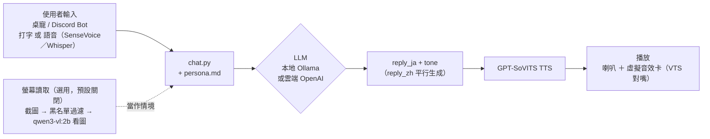

# LLM Voice Chatbot Platform

一個**完全本地優先、也可選雲端**的角色語音聊天平台：LLM 生成台詞、GPT-SoVITS 生成語音，透過桌寵視窗或 Discord bot 互動。內建範例角色（BanG Dream! Ave Mujica 的豐川祥子）僅供展示接線方式，平台本身設計成可換成任何角色。姊妹專案 [voice-dataset-toolkit](https://github.com/kukuo2510/voice-dataset-toolkit) 負責從你自己的素材訓練新角色的聲音。

A **local-first, cloud-optional** character voice chatbot: an LLM writes in-character replies, GPT-SoVITS voices them, and you talk to it via a desktop-pet window or a Discord bot. Sister project [voice-dataset-toolkit](https://github.com/kukuo2510/voice-dataset-toolkit) trains a new character's voice from your own footage.

> Windows only（桌寵視窗用了 Windows 專屬的透明視窗技巧）。

---

## 這個平台做什麼 / What it does

- 打字或按住熱鍵語音輸入，角色用日文回覆＋中文翻譯＋語氣標籤（開心/嚴肅/猶豫…），TTS 依語氣切換聲音表現
- 兩種前端：桌面上飄浮的透明立繪視窗（「桌寵」），或 Discord bot（文字/語音頻道皆可）
- 對話用的 LLM/STT 可以是本地（Ollama/SenseVoice，免費）或雲端（OpenAI），`.env` 明確選擇
- 選用功能：桌寵會定期看一眼螢幕、自己決定要不要主動找你聊天（見下方架構圖／設計決策）

---

## 架構 / Architecture



---

## 幾個值得一提的設計決策

- **本地/雲端二選一，不自動偵測切換**：`LLM_PROVIDER`／`STT_PROVIDER` 要在 `.env` 明確設定，環境裡剛好有 API key 也不會被拿去用——避免使用者以為在跑本地、其實悄悄接了雲端。
- **螢幕讀取的隱私設計刻意選字串比對，不做 AI 內容偵測**：擷取前用視窗標題/程式名稱比對排除清單，命中就整個跳過、連截圖都不產生。連 Microsoft Recall 那種規模的團隊做「AI 判斷畫面內容敏不敏感」都測不準，所以這裡選可靠但陽春的方式，而不是假裝能自動偵測所有敏感內容。開關本身也不是靠改設定檔——啟動時跳出詢問視窗，右鍵選單隨時可切換。
- **看圖模型的細節程度是提示詞問題，不是模型能力問題**：一開始要求「不用列細節、抓重點就好」，結果 2B 模型描述變得空泛、角色也只會講「需要幫忙嗎」這種空話；改成明確要求具體細節後，同一顆模型就能講出畫面裡實際的標題/文字。踩過這個坑之後才決定不用急著換更大的模型。
- **TTS 斷句方法從 `cut5` 換成 `cut3`**：GPT-SoVITS 內建的 `cut5` 連逗號都切成獨立合成段落，段落一多、銜接空隙聽起來像講到一半拖了一下；改成只在句號切之後，A/B 測試確認總靜音時間、最長停頓都明顯下降。
- **對話文字跟語音生成平行處理**：`reply_ja`（餵給 TTS）產生後立刻開始語音合成，同時另一條執行緒平行跑 `reply_zh` 的翻譯，不用等翻譯完成才能開口。

---

## 安裝與執行 / Setup & Run

```bash
conda create -n tts-platform python=3.10 && conda activate tts-platform
pip install -r requirements.txt

# GPT-SoVITS 是獨立上游專案，另外 clone 到這個 repo 根目錄下的 GPT-SoVITS/
git clone https://github.com/RVC-Boss/GPT-SoVITS
# 並先 ollama pull qwen2.5:14b（對話）、ollama pull qwen3-vl:2b（選用，螢幕讀取用）

copy .env.example .env   # 填入需要的 token/key，細節見檔案內註解
```

雙擊 `.bat` 檔啟動：`start_desktop_pet.bat`（桌寵）、`start_discord_bot.bat`（Discord bot）、`talk_to_sakiko.bat`（終端機 demo）、`start_tts_inference.bat`（TTS 服務，通常不用手動開，其他入口點會自動偵測啟動）。

換成自己的角色：複製 `characters/sakiko/` → `characters/<角色>/`，換掉 `persona.md`、`voice_config.py`、`avatar/` 內容，語氣參考音檔要自己準備好（`voice-dataset-toolkit` 訓練/匯出的產物，或自己錄的），再把 `tts_infer.py`/`chat.py`/`desktop_pet.py` 裡寫死 `sakiko` 的路徑換掉。

---

## 版權與內容聲明 / Copyright & Content

這個 repo 只包含**工具程式碼**，不含任何動畫/影片素材、字幕、訓練音檔（含 `characters/*/voice_refs/`）、微調好的模型權重、`.env` 裡的金鑰。使用這些工具處理的任何第三方著作權內容，版權歸原作者所有，使用者需自行負責取得合法授權；範例角色內容（`characters/sakiko/`）僅供展示接線方式，不代表官方授權內容。

This repository ships **tooling only** — no anime footage, subtitles, training audio, fine-tuned model weights, or secrets. Any third-party copyrighted material you process with these tools remains the property of its original rights holders; you are responsible for using it lawfully.

程式碼採 [MIT License](LICENSE)，只涵蓋這個 repo 裡的程式碼，不代表你對第三方素材有任何授權。
